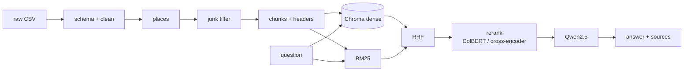

# 🗺️ Tourist RAG — Russian-language landmark assistant

Retrieval-Augmented Generation over a noisy, multimodal landmarks dataset (WikiData descriptions, BLIP image captions, coordinates).
Ask in Russian — by name (*"Что такое Золотые ворота во Владимире?"*) or by description (*"Какая белая башня стоит в Екатеринбурге?"*) — and get a grounded answer with sources.

> Built as a project on top of the MIPT DLS RAG assignment, extended into a tested, reproducible package with a measured ablation.

## Highlights
- **Data engineering**: automatic schema detection, per-landmark aggregation (many photos → one place), near-duplicate removal, two description strategies (`longest` / `concat`).
- **Junk filtering** (memes, banners, selfies): TF-IDF atypicality + regex rules over BLIP captions + zero-shot embedding margin, with a manual-review table.
- **Hybrid retrieval**: multilingual-e5 dense vectors in **Chroma** + **BM25** (prefix-stemmer for Russian) fused with **Reciprocal Rank Fusion**.
- **Reranking**: ColBERT via **RAGatouille** and multilingual cross-encoder (`bge-reranker-v2-m3`), switchable; chosen by ablation.
- **Prompting**: contextual chunk headers, coordinates in context, "best-at-the-edges" ordering (lost-in-the-middle), refusal when context is insufficient.
- **Evaluation without the `ragas` library**: own implementations of *answer relevancy, faithfulness, context precision, context recall* (LLM-as-judge, injectable callables, NaN-on-judge-failure) + Hit@k / MRR, split by *named* vs *blind* questions.
- **Engineering**: 22 unit tests on fakes (no GPU/network needed), CI, CLI, Gradio demo, PCA/UMAP embedding visualisation.



## Quick start
```bash
pip install -e ".[ml,viz,app]"        # + pip install ragatouille  (optional ColBERT reranker)
python -m touristrag.cli build --data data/file.csv        # downloads the dataset if missing
python -m touristrag.cli ask "Какой кремль находится в Нижнем Новгороде?"
python -m touristrag.cli eval -n 100 --full                # writes results/metrics.json
python app.py                                              # Gradio demo
pytest -q                                                  # tests (no models needed)
```
Colab: open `notebooks/hf_rag_solution.ipynb` (T4 GPU is enough with Qwen2.5-3B).

## Data
~14.6k records (photo + BLIP caption `en_txt` + short WikiData description) → **293 unique landmarks in 4 cities** (Yekaterinburg, Yaroslavl, Vladimir, Nizhny Novgorod). Descriptions are very short (median ~29 chars, e.g. "здание в Екатеринбурге"), which is why the BLIP caption chunk matters for descriptive ("blind") queries.

## Evaluation protocol
1. Stratified sample of ≥100 **distinct** landmarks (round-robin over cities).
2. An LLM writes a question + reference answer from each description; 50 % are **blind** (landmark name forbidden) so lexical matching can't win.
3. Retrieval is scored with Hit@k / MRR against the gold landmark; generation with the RAGAS-style metrics.

### Results
100 synthetic questions over 355 clean landmarks (4 cities), Qwen2.5-3B-Instruct as generator/judge, Colab T4. Retrieval is scored by gold landmark (place id); *named* questions saturate (MRR = 1.0 for every variant), so the table shows the **blind** split, which is the informative one.

| Variant | Hit@1 | Hit@3 | Hit@5 | MRR | MRR (blind) |
|---|---|---|---|---|---|
| dense (e5 + Chroma) | 0.50 | 0.57 | 0.62 | 0.560 | 0.532 |
| BM25 | 0.28 | 0.33 | 0.35 | 0.313 | 0.269 |
| hybrid (RRF) | 0.34 | 0.43 | 0.53 | 0.419 | 0.382 |
| **hybrid + cross-encoder** | **0.61** | **0.74** | **0.75** | **0.675** | **0.655** |
| hybrid + ColBERT (RAGatouille) | n/a | n/a | n/a | n/a | n/a |

| RAGAS-style (own impl.) | answer relevancy | faithfulness | context precision | context recall |
|---|---|---|---|---|
| mean | 0.807 (n=100) | 0.725 (n=29/30) | 0.834 (n=30) | 0.611 (n=30) |

**Findings**
- Cross-encoder reranking is the clear win: MRR 0.560 → 0.675 and Hit@3 0.57 → 0.74 over the best first-stage retriever.
- Plain RRF fusion *hurt* (0.419 < dense 0.560): BM25 matches Russian queries against English BLIP captions poorly and injects noise. A weighted fusion or BM25 restricted to Russian description chunks is the obvious next experiment.
- ColBERT via RAGatouille could not be run: the package is incompatible with current `langchain`/`transformers` in Colab (`langchain.retrievers`, then `all_tied_weights_keys`).
- Duplicate landmarks (same name, different WikiData id, e.g. "Нижегородский Кремль" / "Нижегородский кремль") split the relevance mass and make Hit@k pessimistic.

## Design notes & limitations
- Questions are generated by a 3B model from descriptions *and BLIP captions*; many blind questions are about the photo ("что видно на фотографии…") and are only partly answerable from the index, so blind scores are pessimistic, while named scores are trivially perfect. Treat both as relative (ablation) signals, not absolute quality.
- `colbert-ir/colbertv2.0` is English-centric, so the multilingual cross-encoder is the default reranker.
- *Named* questions saturate (MRR = 1.0, the name is in the query); **blind MRR is the informative number**.
- Judge = small open LLM → noisy; unparsable judgements are `NaN` and reported as `n_valid`, never silently 0.
- Refusals ("в контексте нет информации") are forced to 0 in answer relevancy by a regex detector, because a 3B judge misses them; they are excluded from faithfulness.
- RAGAtouille 0.0.9 breaks on `langchain>=1` (`langchain.retrievers` missing) in current Colab; the notebook tries a `langchain-classic` shim and degrades gracefully without ColBERT.
- Own answer-relevancy differs from the `ragas` package in one detail: one LLM call returns all N questions (+ noncommittal flag) instead of N calls.

## Layout
```
src/touristrag/  data · cleaning · chunking · retrieval · pipeline · llm · evaluation · viz · eda · cli
tests/           22 tests on fakes (hashing embedder, scripted LLM)
notebooks/       hf_rag_solution.ipynb (Colab report)
app.py           Gradio demo
```
